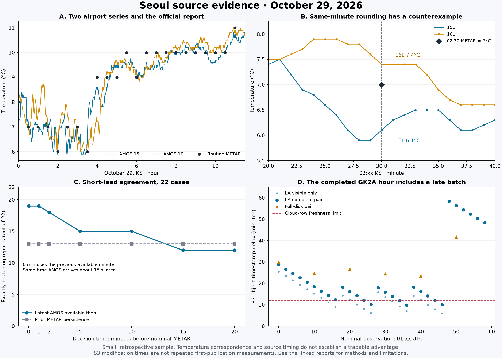

# RKSI AMOS and routine METAR timing study — October 29, 2026

The retained morning observations support a short lead in seeing temperature
changes through AMOS. They do not establish a profitable Polymarket strategy.
For 23 matched routine reports, the corresponding AMOS minute reached our
database a median **4m 16.621s before AWC's recorded provider receipt**. That
is an observation-source timing comparison, not a measured lead over market
participants or executable prices.

A later [13:00 KST forward check](#third-forward-check-at-1300-kst-the-predictions-differ)
predicted the observed **12°C** from AMOS while prior-report persistence
predicted 11°C. The prediction finished sealing 84.392 seconds before the
target, and independent replay verified the retained evidence. It is one
incremental success; the two earlier forward cases matched under both rules.

All wall-clock times below are **KST on October 29, 2026**. The retrospective
sample ends at 11:00, before the afternoon peak. That analysis is an offline review
of retained rows; no orders or production collection changes were made by
the analyzer.



The figure compares recorded source clocks, simultaneous temperature
agreement, decisions made before each coded report time, and the separate
satellite publication sample. It does not show a market lead or trading
returns. A [vector version](assets/seoul-source-evidence-2026-10-29.svg) is
available for inspection and reuse.

## Data and clocks

The day export contains 690 distinct representative AMOS observations for
`rwyNo=2`, `rwyDir=15L`, including **687 marked one-minute observations**, and
23 routine METARs from 00:00 through 11:00. No retained routine report has a
valid `T` plus eight-digit temperature remark. The comparison therefore uses
the reports' whole-degree body temperatures. The absence of such remarks in
this sample does not establish their absence in future reports.

The analyzer prefers a one-minute AMOS row when both cadence types share an
observation time. AMOS latency below uses its recorded `firstSeenAt` only.
The METAR rows have no `firstSeenAt`, so their local persistence clock uses
database `_creationTime`. This is insertion time, not necessarily the first
public availability of the report. The historical decision checks use the
later of that receipt clock and `updatedAt`; a later revision must not inherit
the earlier version's availability.

| Clock comparison | Sample | Median | p90 | Range |
| --- | ---: | ---: | ---: | ---: |
| One-minute AMOS first receipt minus coded observation time | 687 | 15.416s | 16.4702s | 12.890–19.913s |
| Retained METAR insertion minus coded observation time | 23 | 4m 39.028s | 5m 39.025s | 4m 39.023s–5m 39.030s |
| AWC provider receipt minus coded observation time | 23 | 4m 32.124s | 4m 41.765s | 4m 22.964s–4m 54.852s |
| Retained METAR insertion minus AWC provider receipt | 23 | 8.893s | 56.290s | −0.256s–63.152s |
| AWC provider receipt minus corresponding AMOS first receipt | 23 | **4m 16.621s** | 4m 25.790s | 4m 7.529s–4m 38.391s |

A bounded AWC JSON response was captured at 11:32:52 KST. All 23 routine
observations joined uniquely by RKSI and observation time. An independent
comparison found identical raw report content after removing an optional
leading `METAR` and normalizing whitespace. All 23 persisted report times are
unique and belong to the selected date; none had an `updatedAt` more than a
second after its creation clock in this export. The analyzer now repeats that
raw-content comparison as part of the AWC join and reports excluded rows.
This run excluded zero report rows and zero AWC matches.

AWC documents machine-readable worldwide METAR access and requests bounded
query frequency and scope. Its API receipt metadata is distinct from the
time our client first saw a response. The once-per-minute cache update
frequency is also distinct from an individual station's reporting cadence.
See the [official AWC Data API documentation](https://aviationweather.gov/data/api/).

The small negative local-minus-AWC difference for one report is a reason not
to infer subsecond ordering between those systems. Neither source clock
proves that the same report was unavailable from another official channel.

## Concurrent agreement is different from a pre-report prediction

Rounding the AMOS value at exactly the METAR observation minute to the nearest
whole degree, with exact halves toward the higher integer, matched **22 of
23** retained routine temperatures. Those AMOS rows arrived roughly 15
seconds after the coded observation minute. This is concurrent temperature
correspondence; it is not 22-of-23 accuracy for a prediction made before that
minute.

The separate lead study places a decision clock at the report's coded time
minus a fixed lead. It permits only an AMOS observation no older than three
minutes whose observation and recorded receipt clocks both precede or equal
that decision. Its baseline is the latest earlier routine report already
inserted by the same decision clock. A zero-minute decision therefore uses
the preceding available AMOS minute, not the same-minute value that arrived
later. The first report lacks a same-day prior-report baseline, leaving 22
comparisons at each lead in this export.

| Decision before coded report time | AMOS exact matches | Prior-METAR exact matches | AMOS mean absolute error | Baseline mean absolute error |
| --- | ---: | ---: | ---: | ---: |
| 0 minutes | **19/22** | 13/22 | 0.136°C | 0.500°C |
| 1 minute | 19/22 | 13/22 | 0.136°C | 0.500°C |
| 2 minutes | 18/22 | 13/22 | 0.182°C | 0.500°C |
| 5 minutes | 15/22 | 13/22 | 0.318°C | 0.500°C |
| 10 minutes | 15/22 | 13/22 | 0.318°C | 0.500°C |
| 15 minutes | 12/22 | 13/22 | 0.455°C | 0.500°C |
| 20 minutes | 12/22 | 13/22 | 0.455°C | 0.500°C |

At zero-minute lead, AMOS reduced absolute error on seven comparisons and
increased it on one. Nine subsequent reports changed from the available
prior-report temperature; AMOS matched seven of those nine. These are
descriptive counts from one partial day, not independent trials or validated
future response probabilities. No saved lead-study row violated its recorded
decision-time availability checks.

The results favor investigating a short reporting-lag window. They do not
demonstrate a durable advantage at longer horizons. Rounding the next report
correctly also does not predict the final daily maximum, which can rise in
later routine reports.

## The mismatch and the small number of new highs

The sole concurrent mismatch is the **02:30** report:

| Reading | Temperature |
| --- | ---: |
| Retained and independently matched AWC routine METAR | 7°C |
| Representative AMOS 15L minute | 6.1°C, rounding to 6°C |
| Separately retained AMOS 16L minute | 7.4°C, rounding to 7°C |

Both AMOS site rows retained `rwyMain=15L`. The fact that the 16L value rounds
to the report does **not** prove that METAR selected that sensor, that the
main sensor switched, or that the temperature averages represent the same
time interval. Averaging, source selection, and the precise instrument
mapping require independent official evidence. The mismatch rules out a
deterministic claim that the representative 15L minute always converts to
the official whole-degree temperature.

Across all 23 report times, 15L agreed after rounding on **22**, while 16L
agreed on **16**. The two site values rounded to different integers on **eight**
occasions. Substituting 16L only for the one 15L mismatch would choose the
sensor after seeing the answer. It would not establish a prospective rule.

The separate [official-source investigation](./seoul-edge-research-2026-10-29.md)
found that the public minute temperature represents six readings collected
ten seconds apart and averaged over a minute. It also verified whole-degree
reporting with half-degree ties toward the warmer integer. The inspected
temperature instructions do not establish the exact AMOS cutoff used by each
issued METAR. Thus these timing and agreement counts do not establish either
access to instantaneous ten-second readings or an exact reconstruction of
the official reporting process.

Only **three reports raised the retained daily high after the midnight
baseline**: 04:00 to 9°C, 05:30 to 10°C, and 11:00 to 11°C. Their concurrent
15L AMOS values were 8.6°C, 9.5°C, and 10.8°C respectively. The remaining
matches mostly concern readings that did not raise the day's qualifying
maximum. Counting all 23 as actionable daily-high signals would substantially
overstate the evidence. Later reports and the completed day's maximum are
outside this sample.

## New-high alerts, false alerts, and missed increases

The analyzer also keeps a separate decision ledger for a narrower question:
does the rounded AMOS prediction exceed the rounded maximum of the same-day
routine reports available by this decision? Its baseline is that available
maximum, not the latest report's temperature. The outcome is whether the
target routine report exceeds the same baseline. This measures a predicted
increase in the daily-high **integer bucket at that target report**; it does
not predict the completed day's maximum or count tenths-degree increases
within an unchanged integer bucket.

Each horizon contains all **23 retained target reports**, with **22 scored
decisions and one abstention** at midnight. That first decision has neither an
available same-day report baseline nor a recent same-day AMOS observation.
The ledger stores the target and decision clocks, selected AMOS observation,
receipt and revision clocks, its age and cadence, the confirmed maximum and
supporting report clocks, and each abstention reason. Multiple missing inputs
can explain one abstention.

| Decision before coded report time | True new-high alerts | False alerts | Missed new highs | Correct no-increase decisions | Abstentions |
| --- | ---: | ---: | ---: | ---: | ---: |
| 0 minutes | 3 | **1** | 0 | 18 | 1 |
| 1 minute | 3 | **1** | 0 | 18 | 1 |
| 2 minutes | 3 | **1** | 0 | 18 | 1 |
| 5 minutes | 2 | 1 | 1 | 18 | 1 |
| 10 minutes | 1 | 0 | 2 | 19 | 1 |
| 15 minutes | 0 | 1 | 3 | 18 | 1 |
| 20 minutes | 1 | 0 | 2 | 19 | 1 |

The false alert at zero-minute lead was **05:00**. The 04:59 AMOS reading was
**9.5°C**, recorded at 04:59:15.421, which rounded to **10°C** against an
already confirmed maximum of **9°C**. The 05:00 routine report remained
**9°C**. The later 05:30 report reached 10°C, but that later success does not
turn the incorrect 05:00 prediction into a correct target-report forecast.
The 0-, 1-, and 2-minute rules each produced four alerts: three correct and
one false. These are four events from one morning, not an estimated future
success probability. A false temperature alert also cannot be translated
into a trading loss without a defined order, price, and execution record.

The baseline here uses local report persistence and revision clocks. AWC
receipt metadata is a separate source comparison and is not substituted for
a client capture that never occurred. No selected sample arrived after its
decision. No input AMOS row had a revision more than one second after its
first receipt, and there were no temperature disagreements between the
retained one- and five-minute rows at shared timestamps. The export contains
three timestamps with only a five-minute row: 09:35, 10:05, and 10:35.

For future inputs, this ledger abstains if a previously received report was
overwritten after the decision, or if a prior report timestamp has ambiguous
versions. Simply discarding such a report could make the reconstructed
maximum too low. It also abstains when the latest relevant AMOS version was
overwritten after the decision. These guards prevent known revision leakage;
they cannot recover unrecorded versions or establish that a retained source
history is complete.

## Fixed lags and short averages do not explain the mismatch consistently

A separate exploratory follow-up applied the same nine recipes to all 23
retained reports: the exact AMOS minute at `T`, `T−1`, through `T−5`, and
equal means of the strictly preceding 1, 2, or 5 minutes (`T−n` through
`T−1`). Every required minute had to exist; no imputation or selected runway
substitution was allowed. The one-minute mean intentionally duplicates
`T−1`. The family was fixed before this follow-up ran, after the morning's
data had already been inspected; it was not prospectively preregistered.

Input temperatures were verified to be on a tenth-degree grid. Sums use
integer tenths, and exact half-degree means round toward the warmer integer
directly from that sum, avoiding floating-point accumulation at a threshold.
Each public minute value is already an average, so these additional means do
not establish the official reporting window.

The concurrent recipe has 23 usable comparisons. Every other recipe lacks
only the midnight target's required previous-day observations, leaving 22.
The common comparison therefore uses the same 22 targets, 00:30–11:00, for
all recipes. New-high counts below use those 22 targets and the maximum from
routine reports locally available by `T`, with the same integer-bucket
definition as above.

| Recipe | Matches / available | Missing targets | Matches / common targets | True new-high alerts | False alerts | Missed increases |
| --- | ---: | ---: | ---: | ---: | ---: | ---: |
| Minute `T` | 22/23 | 0 | 21/22 | 3 | 0 | 0 |
| Minute `T−1` | 19/22 | 1 | 19/22 | 3 | 1 | 0 |
| Minute `T−2` | 19/22 | 1 | 19/22 | 3 | 1 | 0 |
| Minute `T−3` | 18/22 | 1 | 18/22 | 3 | 1 | 0 |
| Minute `T−4` | 18/22 | 1 | 18/22 | 3 | 0 | 0 |
| Minute `T−5` | 16/22 | 1 | 16/22 | 2 | 0 | 1 |
| Preceding 1-minute mean | 19/22 | 1 | 19/22 | 3 | 1 | 0 |
| Preceding 2-minute mean | 19/22 | 1 | 19/22 | 3 | 1 | 0 |
| Preceding 5-minute mean | 18/22 | 1 | 18/22 | 3 | 0 | 0 |

These observation offsets are **not decision leads**. None of the 23
same-minute values was available at `T`; the other recipes' 22 input sets
were available then. All compared inputs preceded the target report's local
receipt, which does not establish when other sources or traders obtained it.
The earlier five-minute decision-lead study generally used `T−6`, because
the `T−5` value had not arrived when that decision was made. Its counts must
not be relabeled as this fixed five-minute observation lag.

Only `T−5` repairs the 02:30 discrepancy: its 6.6°C rounds to the reported
7°C. But it introduces six other mismatches, at 00:30, 02:00, 04:00, 04:30,
06:30, and 07:00, and misses the 04:00 new high. The preceding five-minute
mean at 02:30 is 6.18°C, still rounding to 6°C. No tested fixed lag or mean
improves overall agreement across the common targets.

At 05:00, `T−4` and the preceding five-minute mean remove the false
new-high alert: they yield 9.4°C and 9.46°C respectively, both rounding to
9°C. Each nevertheless matches only 18 of 22 report temperatures. Choosing
either because it handles these three new highs without a false alert would
select and evaluate a rule on the same data. The sample supports **no fixed
lag or averaging change to operational behavior**. Sensor selection and the
actual reporting cutoff remain unresolved.

The [fixed-window analyzer](../scripts/analyze-seoul-report-windows.mjs) and
[full per-target evidence](assets/seoul-amos-report-windows-20261029.json)
preserve all nine recipes, missing observations, sample values and clocks,
input and script hashes, and limitations, without database record IDs. They
use the original frozen day export and make no network requests or production
changes. The separate forward checks below are not included
in this exploratory family.

## Method limits and the next experiment

The analyzer requires an explicit date, matching KST observation dates, RKSI,
and routine METAR classification. It excludes every candidate at a duplicate
report timestamp instead of choosing a convenient revision. The AWC join
requires exactly one matching station/time/type record, a valid receipt
clock, and matching normalized raw content; missing, ambiguous, or different
reports are recorded as exclusions. No such exclusions occurred in this
sample. These conservative rules describe this source audit, not the full
contract's settlement procedure, which also addresses unlabeled reports,
corrections, and fallback sources.

The opportunity count is conditional on retained reports. The analyzer does
not yet generate a complete, predeclared schedule or count a routine report
that was expected but never retained. Its one-minute AMOS preference is also
chosen from the final export before applying decision-time availability, so
it cannot fully replay which alternative cadence was available then. The
new-high ledger makes abstentions visible among retained targets; it does
not remove these selection limits. All seven horizons reuse the same day's
temperature path and three new highs. They are correlated views, not seven
independent validations, and the best-looking horizon must not be selected
as a tested strategy using these same results.

Mutable source records can hide earlier versions even when a receipt clock
passes a historical cutoff. The present analysis is therefore clock-filtered
retrospective evidence, not an immutable as-of backtest. Exclude revised rows
from a prospective score unless the exact version available at the decision
was frozen. Taking the maximum of the receipt and update clocks prevents the
known current version from being available too early; it does not recover
the overwritten version. Do not use a later correction with an earlier
insertion clock.

The next useful experiment is prospective and initially paper-only:

1. Predefine the expected routine slots, decision times, and signal rule before
   the next observation. Record missing expected reports and off-schedule
   reports separately instead of choosing favorable opportunities afterward.
   Keep every scheduled decision in a ledger, including abstentions and their
   reasons, and record the maximum actually known at that decision.
2. At the first receipt of the corresponding AMOS minute, freeze its raw
   payload, source observation time, receipt time, all available site readings,
   current contract rules, and the maximum confirmed at the contract's source.
   Retain an immutable prediction before the target report arrives.
   Preserve source versions with both observation and client receipt times;
   replay events by receipt time, choosing among the cadences then available.
3. After the required market-data access, retention, and display scope is
   authorized, freeze contemporaneous YES bid/ask prices, book timestamps,
   receipt timestamps, spreads, available sizes, and applicable fees. Measure
   later market changes against those records; a last-trade state is not a
   current executable price or an execution timestamp.
4. Score held-out days and new daily-high bucket changes separately from all
   routine reports. Include mismatches, source outages, ambiguous revisions,
   and unsuccessful opportunities. Separate prediction accuracy, potential
   quote response, hypothetical fills, and cost-adjusted results. Treat days
   and weather episodes as dependent groups when quantifying uncertainty;
   this single partial day cannot estimate between-day variation.
5. Test whether the satellite trend adds information beyond an AMOS,
   prior-report, and KMA-forecast baseline using the same frozen decisions.
   Do not choose satellite thresholds after inspecting the evaluation period.

This study contains no executable-quote history, fills, order latency, fee
calculation, or realized trading results. Its strongest conclusion is a
measured observation-source lead worth testing against future market evidence.

## Reproduction

### One predeclared forward check at 12:00 KST

After completing the retrospective audit, the query for the same simple
rounding rule completed at **11:58:30.249 KST**, 89.751 seconds before the next
expected routine METAR, and the prediction was saved before that target.
The latest one-minute 15L AMOS value was **11.0°C at 11:58**,
first received by the database at 11:58:15.409. It predicted **11°C** and no
increase above the confirmed local maximum of 11°C. Prior-report persistence
also predicted 11°C.

The first observed AWC version of the **12:00 KST METAR was 11°C**. Its
provider receipt field was 12:04:29.187; the bounded one-minute probe first
saw it at 12:05:04.492, after an unsuccessful 12:04:03.410 response.
These are separate clocks, not an exact first-publication time. Both the
AMOS rule and the baseline matched, so this single forward case establishes
no incremental prediction advantage and no daily-high event.

The [retained forward-check evidence](assets/seoul-prospective-metar-202610290300.json)
includes the frozen rule, source times, polling results, raw AWC outcome,
and hashes of the local capture and separately frozen prediction. It is
reported separately from the retrospective sample. The prior maximum uses
the local NOAA TGFTP routine reports, so this is a source-comparison test,
not a complete adjudication of AWC revisions or contract settlement.
The [bounded prospective probe](../scripts/probe-seoul-next-metar.mjs)
creates a new output and prediction file exclusively and stops after one
target or a ten-minute outcome timeout. It performs no market requests.

### Second forward check at 12:30 KST

The unchanged rule's next query completed at **12:29:11.141 KST**, 48.859
seconds before the 12:30 target. Its latest captured 15L reading was
**11.2°C at 12:28**, first received by the database at 12:28:15.408. The
prediction was again **11°C**, with a persistence baseline and known local
maximum of 11°C. The exclusively created prediction file's retained local
modification clock is 12:29:11.143; that filesystem timestamp is separate
from a provider clock or a cryptographically attested timestamp.

AWC's first observed 12:30 version was **11°C**. Its provider receipt was
12:34:29.443, and this probe first saw it at 12:35:02.980 after a response
without the report at 12:34:02.558. The
[second forward-check record](assets/seoul-prospective-metar-202610290330.json)
retains the outcome, poll clocks, and original prediction hash. Both rules
matched in both forward cases; neither case involved a new daily high.
They add no evidence of an incremental advantage over persistence, and two
opportunities selected during this investigation are not a complete
predeclared schedule of opportunities.

Both captures used version 1 of the local probe. Its `frozenAtUtc` field was
a query-receipt/preparation clock, not a measured filesystem-sync completion
clock. The original captures are preserved. Future strict captures must
record decision preparation, immutable-file completion and outcome receipt
separately, and refuse to score a prediction completed after its target.

The subsequent [version 2 recorder](./seoul-paper-ledger-design-2026-10-29.md)
implements these safeguards and passed 27 offline helper/integration tests.
It retains both KST source-day snapshots, separate preparation and file-sync
completion clocks, immutable raw AWC responses, and explicit abstentions.
Its timing and byte limits were tested with fixtures. The first live v2
validation follows below; it does not retroactively strengthen either v1
capture.

### Third forward check at 13:00 KST: the predictions differ

This target and a 12:58:30 invocation were fixed before querying the current
source values. The recorder preserved both KST dates, prepared its decision
at **12:58:35.469**, and finished writing, syncing and closing the prediction
file at **12:58:35.608**—**84.392 seconds before the target**. The 15L
one-minute value at 12:58 was **11.7°C**, predicting **12°C**. Persistence
predicted **11°C**. All 26 earlier expected same-day routine slots were
present, with a known local maximum of 11°C and no rejected prior rows.

The first qualifying AWC version observed by this probe was:

```text
METAR RKSI 290400Z 15009KT CAVOK 12/02 Q1020 NOSIG
```

It reported **12°C**, so the AMOS prediction matched, persistence missed,
and the outcome exceeded the previously known local routine maximum.
There was no T remark or correction marker in this captured version. AWC's
provider receipt was **13:04:42.583**; the client first observed it at
**13:05:00.361**, after a response without it at **13:04:00.516**.
The provider receipt was 6m06.975s after prediction sealing. That is a
recorded source-clock comparison, not the first availability to every
observer or a lead over market prices.

The [sanitized v2 evidence](assets/seoul-prospective-metar-202610290400-v2.json)
retains the predeclared target, source and prediction hashes, separate
preparation/seal clocks, coverage, all five poll records, the parsed raw
outcome, and score. The full snapshots and original response bytes remain in
the ignored local evidence directory. Independent replay verified their hash
chain and reproduced the decision and score. The process exited after the
qualifying outcome; no recurring collection was started.

| Target, KST | Recorder | AMOS prediction | Persistence | Observed routine METAR |
| --- | --- | ---: | ---: | ---: |
| 12:00 | v1 | 11°C | 11°C | 11°C |
| 12:30 | v1 | 11°C | 11°C | 11°C |
| 13:00 | v2 | **12°C** | 11°C | **12°C** |

The third case is one forward example in which the minute source supplied
useful information beyond persistence. Three adjacent reports on one day,
with different capture versions and without a complete predeclared daily
schedule, do not validate an accuracy rate or a repeatable trading strategy.
Later corrections, final daily settlement and contemporaneous executable
quotes were not evaluated.

### Retrospective reproduction

The [offline analyzer](../scripts/analyze-seoul-amos-metar.mjs) performs no
network calls or production writes. From the repository root:

```text
node scripts/analyze-seoul-amos-metar.mjs tmp/seoul-restore/2026-10-29-day.json tmp/seoul-amos-metar-audit-2026-10-29.json tmp/seoul-awc-18h-2026-10-29.json
```

The output preserves the original report and lead comparisons and adds
`newHighStudies`, whose full rows retain all target opportunities and
abstentions. Synthetic clock, revision, maximum-baseline, false-alert, and
missed-increase checks run with:

```text
node --test test/seoul-amos-metar-analysis.test.mjs
```

The day input is a stored `seoul:getDayStationRows` response. The optional
third argument is an AWC capture shaped as `{ checkedAt, rows }`. The
secondary-site cross-check uses the separate retained array in
`tmp/seoul-amos-sites-audit-2026-10-29.json`; it is not an input to the
prediction scores. Its 23-time summary is saved in
`tmp/seoul-amos-site-comparison-2026-10-29.json`. These exports remain in ignored local research storage.
Do not overwrite the frozen inputs when collecting later observations.

### Fixed-window reproduction

The raw input remains in ignored local research storage. Its SHA-256 is:

```text
f559cc4b81380b2add1f6436b84f12d665c93236e3d29fd149c72f9d2e32b73d
```

Reproduce all nine recipes into a new output path:

```text
node scripts/analyze-seoul-report-windows.mjs tmp/seoul-restore/2026-10-29-day.json tmp/seoul-report-windows-reproduction.json
```

The analyzer creates the output exclusively and refuses to overwrite an
existing file. Generated timestamps differ on reruns; compare the input hash,
recipe definitions, per-target rows, and summaries. The saved public evidence
contains the selected values, public report contents and receipt clocks
needed to inspect the comparisons, while the complete original source export
remains local. Synthetic checks cover positive and negative half-degree means,
missing interior minutes, conflicting cadence records, denominator retention,
ID removal, and refusal to overwrite a saved result:

```text
node --test test/seoul-report-windows.test.mjs
```
