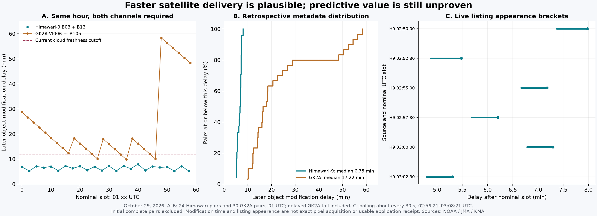
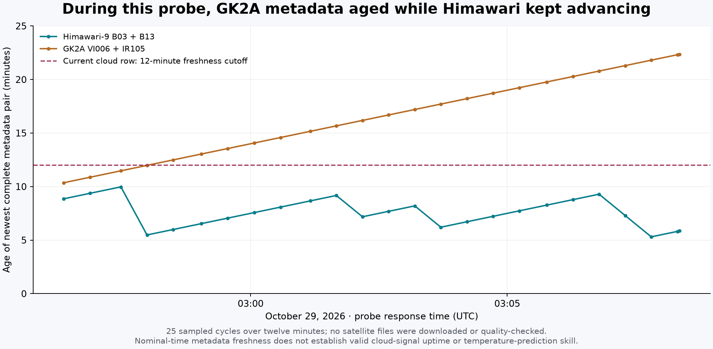

# Seoul source and timing research — October 29, 2026 KST

This investigation supports the RKSI temperature and satellite signals. It uses
current official manuals, bounded public metadata requests, one decoded GK2A
pair and four decoded Himawari pairs. Production release status belongs in `docs/seoul.md`; this
report does not activate any approval-dependent integration.

The subsequent [eleven-hour metadata comparison](./seoul-satellite-metadata-comparison-2026-10-29.md)
extends this report's single-hour result across 594 expected slots and retains
all missing pairs. A separate
[local download/decode benchmark](./seoul-himawari-review-2026-10-29.md#local-download-and-decode-benchmark)
measures processing of an already available pair; it does not measure live
availability or Convex performance.

## Review status

The GK2A cloud row is deployed alongside the existing sunlight reading. Its
twelve-minute freshness limit remains in force, so the observed delivery
delays can leave the row unavailable. The Seoul Polymarket panel and collector
are also deployed, with data collection and display disabled pending the
separate RKSI access, retention, and publication scope documented in
[the integration notes](./seoul-polymarket.md). Production quote collection
and trading remain inactive.

The practical research priorities are now narrower:

| Question | Evidence so far | Evidence still needed |
| --- | --- | --- |
| Can AMOS anticipate the next routine METAR? | The 13:00 KST forward check predicted the observed 12°C while persistence predicted 11°C. Two earlier checks matched 11°C under both methods. | More sealed decisions across days and changing temperatures, retaining missing reports, corrections, and persistence. One incremental success is not a validated accuracy rate or market advantage. |
| Can Himawari keep a paired cloud input fresher? | All ten fully covered comparison hours favored its median object timestamp; six new pairs appeared during the short live listing probe. | First usable receipt after download, decoding, and quality checks in the intended runtime, plus longer coverage. |
| Does the imagery predict airport warming or cooling? | Four calibrated pairs cover RKSI and allow descriptive channel trends. | Ground sunlight and subsequent temperature validation, including cloud geometry and shadow displacement. Raw brightness is not a validated temperature signal. |
| Is a more precise public temperature feed available? | AMOS provides 0.1°C minute averages; the manual documents six underlying ten-second readings. | A verified authorized source for the underlying readings or reporting workflow. Neither extra decimals nor faster polling supplies that evidence. |

The [AMOS study](./seoul-amos-metar-study-2026-10-29.md) retains all three forward
outcomes and the failed retrospective comparisons. A
[hardened paper recorder](./seoul-paper-ledger-design-2026-10-29.md) is ready
for further bounded comparisons, passed 27 offline tests, and captured the
13:00 result with a prediction sealed 84.392 seconds before the target.
Production source changes and any approval
activation remain separate from these research findings.

## Findings that change the interpretation

1. **The public minute temperature is already an average.** The current AMO
   equipment manual specifies six temperature readings collected ten seconds
   apart and averaged over a minute. A public ten-second RKSI temperature feed
   was not verified. Polling the minute endpoint more often cannot recover
   those underlying samples.
2. **Rounding the minute value is useful evidence, not a guaranteed METAR
   reconstruction.** Current instructions specify nearest-integer temperature
   reporting, with half-degree ties toward the warmer integer, but the inspected
   temperature section does not establish the precise AMOS sample cutoff used
   by each issued METAR. A mismatch must remain unresolved unless the actual
   sensor and reporting workflow are demonstrated.
3. **Two-minute satellite acquisition is not two-minute delivery.** A larger
   NOAA S3 sample is substantially slower than the earlier single visible-file
   example. The completed 01 UTC hour's thirty local-area visible/infrared
   pairs had a median object timestamp delay of **17m13s**, with a maximum
   **58m22s**. The initial 24-pair snapshot omitted six late arrivals and its
   16m04.5s median was provisional. The complete pair was not normally available
   as early as the visible channel alone.
4. **Full-disk fallback does not solve that observed delay.** Six full-disk
   pairs had a median delay of 25m42s and much larger files. It would also
   provide only ten-minute acquisition cadence in this sample.
5. **NOAA's public Himawari-9 Japan-area archive is a better raw-channel
   candidate.** In the same 01 UTC hour, 24 B03/B13 pairs had modification
   timestamps a median **6m45s** after their nominal 2.5-minute slots, versus
   the completed GK2A LA hour's **17m13s**. Four later pairs have valid RKSI footprints and
   independently checked calibration. Their actual scan-start-to-object
   delays were 5m13s–6m37s. Nominal slot, scan start/end, and application
   receipt are different clocks; these samples establish neither sustained
   availability nor a validated cloud/temperature prediction method.

## Temperature: current official procedure

The live [AMO manuals index](https://amo.kma.go.kr/information/law.do) was read
on October 29. Search results still pointed to older attachments that the board
has replaced. The current PDFs were downloaded using links from that live index:

- [ISO-I-08 equipment manual, revised October 16, 2026](https://amo.kma.go.kr/servlet/kamaboard?mode=download&bid=lawinfo&num=143&fno=1&callback=https%3a%2f%2famo.kma.go.kr%2finformation%2flaw.do&ses=&k=ATC202610161508141_6Akb0urc376JwSgic54R.pdf),
  PDF page 41 / printed page 37: temperature data unit 0.1°, collection
  interval ten seconds, and a minute output formed from the mean of six
  readings. The manual distinguishes a sensor's sampling interval from the
  processor's data-collection interval; the ten seconds here is the latter.
- [ISO-I-03 observation manual, revised August 26, 2026](https://amo.kma.go.kr/servlet/kamaboard?mode=download&bid=lawinfo&num=124&fno=1&callback=https%3a%2f%2famo.kma.go.kr%2finformation%2flaw.do&ses=&k=ATC202608261443141_e4UjfZVk9DQf5frYrP3e.pdf),
  sections 5.3.6.1–5.3.6.2, PDF pages 29–30 / printed pages 27–28:
  temperature must represent the runway, is observed to a tenth of a degree,
  and is reported at the nearest whole degree. Its examples include +2.5°C
  becoming +3°C and −2.5°C becoming −2°C.

**Resolution, accuracy, and response time are separate quantities.** The
equipment manual defines resolution and accuracy separately in sections
1.3.12–1.3.13 (PDF page 6 / printed page 2). Its Annex 1 (PDF page 39 /
printed page 35) refers temperature/humidity sensor specifications to KMA's
automatic-observation equipment standard. The official [KMA surface-observation
manual, October 2024](https://data.kma.go.kr/resources/images/publication/%EC%A7%80%EC%83%81%EA%B8%B0%EC%83%81%EA%B4%80%EC%B8%A1%EC%A7%80%EC%B9%A8.pdf),
table 19, PDF page 151 / printed page 139, reproduces the March 6, 2023
standard: both listed platinum temperature-sensor types have **0.1°C
resolution and accuracy within ±0.3°C** over their specified −40°C to +60°C
measurement range. The [current official standard record](https://www.law.go.kr/LSW/admRulInfoP.do?admRulSeq=2100000220406&chrClsCd=010201)
identifies KMA Notice 2023-4, effective March 6, 2023. This is a general
equipment requirement, not a calibration certificate or measured uncertainty
for the installed RKSI sensor on this date.

No numeric RKSI temperature-sensor response time or internal measurement
cadence was established. The inspected temperature table does not specify
either. The surface manual's table 31 (PDF page 163 / printed page 151)
calls the ten-second electrical-signal acquisition interval sampling and
again averages six readings per minute; the newer AMOS-specific manual calls
it the processor's collection interval. Neither wording establishes that the
physical probe responds fully within ten seconds, or that the public minute
value measures an instantaneous temperature. More decimal places and faster
polling therefore do not establish greater physical accuracy or recover the
unpublished readings.

The equipment inventory on PDF page 69 / printed page 65 was also checked
visually. It lists primary temperature/humidity sensors at runway 2's 15L
position and runway 3's 16L position, plus a backup at runway 1's midpoint.
It does not show a separate primary temperature sensor at every runway-end
label. A runway identifier therefore needs to remain attached to each reading;
multiple displayed rows must not be assumed to be independent thermometers.
This inventory alone does not identify the sensor used in a particular METAR.

The observation manual's ten-minute average in section 5.3.1.2 is explicitly
for wind. Other sections also describe visibility and RVR averages. Applying
one of those windows to temperature would be unsupported. The temperature
section inspected does not prove a fixed five-minute cutoff, a ten-minute
temperature average, or that a METAR at HH:30 necessarily uses the public
AMOS record labeled HH:30.

The separate production AMOS/METAR audit found a 02:30 KST report with 7°C
while the 15L minute value was 6.1°C. Nearby values include 6.6°C at 02:25,
5.9°C at 02:28–02:29, and 6.5°C at 02:33–02:35. A selected earlier or later
reading can make the rounding agree, but choosing that reading after seeing
the outcome does not establish the reporting rule. Preserve this case as a
counterexample to an exact same-minute identity; do not shift timestamps or
silently substitute a runway merely to make the comparison pass.

The [official AMOS API documentation](https://apihub.kma.go.kr/apiList.do?apiMov=%EA%B8%B0%EC%83%81%EC%B2%AD+AMOS+%EB%A7%A4%EB%B6%84%EC%9E%90%EB%A3%8C+%EC%A1%B0%ED%9A%8C&seqApi=14&seqApiSub=259)
advertises minute, hourly, and daily products. No supported public ten-second
temperature endpoint was established. The new public AMO timeseries page
referenced `/assets/js/amos-timeseries.js?v=20260928-10`, but that script
request returned the site's error page during this check. Its presence in
HTML is not evidence of a working history or higher-frequency API.

The HTML itself provides a useful statement of intended semantics: 1-, 10-,
and 60-minute observation intervals; requested windows up to 24 hours;
runway selection and CSV export; and independent 2-/10-minute **wind**
averaging. It says the ten-minute and hourly selections use clock-boundary
observations. It also says missing or quality-excluded values break chart
lines, visibility uses ten-minute MOR, and pressure uses QNH. These controls
do not establish additional temperature averaging, precision, retention, or
successful history retrieval. The JavaScript returned HTTP 404 again without
the cache-version query and with the normal page Referer.

Historical minute-data availability, station-113 identity checks, and the
separate scope required for an automated archive importer are already recorded
in the [historical analog feasibility investigation](./seoul.md#historical-analog-ensemble-feasibility).
The current API's account/key requirement does not replace that approval
boundary; this follow-up adds no archive downloader.

## Paired GK2A calibration check

One already downloaded VI006 local-area file was paired with its IR105 file
for nominal **01:26 UTC / 10:26 KST**. The production decoder produced 25
valid local cells, median solar-normalized reflectance **0.8091**, and median
infrared brightness temperature **259.174 K**. The two channel files carried
an embedded scene time of 01:26:55 UTC. The inspected infrared calibration
version was `v.3.0_20190415`.

The visible object's S3 timestamp was 01:32:07 and the infrared object's was
01:36:08. Thus this *pair* was timestamped 10m08s after nominal time, or
9m13s after the embedded scene time, although the visible file alone had a
6m07s nominal delay. This verifies a real footprint and decode, not an
irradiance retrieval, total-cloud-amount measurement, or trend forecast.

Both files independently embed **`file_generation_time=01:28:16 UTC`**,
with `data_processing_center=NMSC` and `data_processing_mode=operation`.
They were generated 81 seconds after the embedded scene time, or 2m16s
after nominal time. The S3 timestamps were another **3m51s for VI006** and
**7m52s for IR105** after that generation time. This is direct evidence of
a gap between generation and the NOAA objects' timestamps. It makes an
earlier authorized distribution route worth benchmarking, while proving
neither that such a route exposed the files at generation time nor that the
same delay pattern persists across other frames.

Source objects:
[VI006 sample](https://noaa-gk2a-pds.s3.amazonaws.com/AMI/L1B/LA/202610/29/01/gk2a_ami_le1b_vi006_la005ge_202610290126.nc)
and [IR105 sample](https://noaa-gk2a-pds.s3.amazonaws.com/AMI/L1B/LA/202610/29/01/gk2a_ami_le1b_ir105_la020ge_202610290126.nc).
The retained [paired decode evidence](assets/seoul-gk2a-paired-decode-202610290126.json)
contains the decoded cells and the independently inspected generation times.

## Broader publication-timestamp comparison



Three bounded, non-truncated GK2A S3 listings were captured at approximately
02:35–02:37 UTC, followed by a 01-hour LA recheck at 03:04:23–03:04:25 UTC.
The recheck contains thirty pairs including six that were absent from the
initial snapshot. No full-disk images were downloaded. A later Himawari
listing for the same observation hour is included in the comparison table
and detailed below. The retained GK2A
[CSV evidence](assets/seoul-gk2a-publication-20261029.csv) contains object
keys, sizes, nominal times, modification times, and pair delays; the
[summary JSON](assets/seoul-gk2a-publication-20261029.json) includes exact
listing URLs and local capture timestamps.

The completed-hour correction is retained separately as
[30-pair evidence](assets/seoul-gk2a-complete-hour-2026102901.json) and the
[original late-recheck XML](assets/seoul-gk2a-complete-hour-2026102901.xml).
The request ran from 03:04:23.080 to 03:04:25.113 UTC and its HTTP Date was
03:04:26 UTC. The JSON hashes the XML and can be reproduced offline with
`scripts/summarize-gk2a-listing.py`. The original CSV/JSON remain the initial
snapshot and therefore do not contain the six later arrivals.

For a pair, delay is the later channel's `LastModified` minus its shared
nominal filename time. These are **retrospective object timestamps**, not
repeated absent/present probes establishing first public availability. They
can include source-transfer backlog and object replacement. They do not
include this application's download, decode, or insertion delay.

| Sample | Matched pairs | Minimum pair delay | Median pair delay | Maximum pair delay |
| --- | ---: | ---: | ---: | ---: |
| LA, 01 UTC hour, initial snapshot missing late tail | 24 | 9m48s | 16m04.5s | 28m46s |
| LA, 01 UTC hour, completed late recheck | 30 | 9m48s | **17m13s** | **58m22s** |
| LA, 02 UTC hour, partial snapshot | 10 | 9m58s | 19m38.5s | 28m52s |
| FD, 01 UTC hour | 6 | 23m26s | 25m42s | 41m39s |
| Himawari Japan, 01 UTC hour, nominal 2.5-minute slots | 24 | 5m13s | 6m45s | 7m57s |

The completed 01-hour LA visible channel alone had a median delay of
**13m55s** (range 5m56s–58m22s); the initial 24-frame subset's median was
12m14s. Matching infrared availability is consequently a
material constraint. The later complete pairs should not be represented as
having arrived when only VI006 was uploaded.

The 02-hour listing, whose HTTP response date was **02:36:02 UTC**, contained
14 visible frames through 02:26 but only ten infrared frames: 02:00–02:16
and 02:26. The newest complete pair was therefore about **10m02s old**.
The missing intervening infrared frames show why the count cannot be used to
infer a continuous sequence. This is a source-availability observation made
before application processing.

The initial 01-hour LA listing contained no 01:48–01:58 frames on any of its
sixteen channels. In the late recheck, those six VI006/IR105 pairs were present
with channel object timestamps **02:46:21–02:46:22 UTC**, corresponding to
pair delays of **48m22s–58m22s**. Thus the apparent gap was a delayed delivery
tail in this retained evidence, not evidence for a scheduled scan gap. An
initial non-truncated listing is complete only for objects then listed; it
does not make a recent observation hour complete. Use the thirty-pair result
for this hour's retrospective comparison and retain the original snapshot
to expose this availability-selection bias.

The six FD pair delays were 29m50s, 24m47s, 26m37s, 24m30s, 23m26s, and
41m39s. Individual FD VI006 objects were 488–501 MB. This sample supplies no
evidence that a full-disk fallback would improve freshness. It also does not
justify relaxing the cloud signal's freshness requirement. An unavailable
signal accurately describes the evidence when a fresh validated pair is
missing.

These samples cover a short operational period and must not be treated as
a long-term service-level estimate. The earlier
`seoul-satellite-latency-2026-10-29.md` report's 6m07s visible sample remains
correct for that object, but cannot be generalized to typical paired delivery.

### Bounded live listing probe

A separate, prospective metadata probe ran from **02:56:21.200 to
03:08:21.398 UTC**. It checked the current and preceding UTC-hour prefixes
for both sources roughly every thirty seconds: 100 successful listing
requests, no request errors, and no satellite-object downloads. The 98
complete pairs present in each prefix's first successful listing were
excluded from arrival timing. Six new Himawari pairs were observed; no new
complete GK2A pair appeared within this bounded window.

For a newly complete pair, the lower bound is the preceding successful
listing's request start, when the pair was not yet complete, and the upper
bound is receipt of the first listing containing both bands. These are
conservative **listing-observation brackets on the local clock**, not exact
upload times or application-ready signal times. HTTP Date values were
0.477–1.471 seconds ahead of the client's response-completion clock; the
evidence retains both without silently adjusting either. Polling intervals
include request time and can exceed thirty seconds.

| Himawari nominal slot, UTC | Listing appearance delay after nominal slot |
| --- | ---: |
| 02:50:00 | 7m22.3s–7m58.8s |
| 02:52:30 | 4m52.3s–5m28.8s |
| 02:55:00 | 6m39.8s–7m10.7s |
| 02:57:30 | 5m41.5s–6m12.3s |
| 03:00:00 | 6m46.8s–7m17.6s |
| 03:02:30 | 4m47.4s–5m18.1s |

The six-pair median lies within **6m10.6s–6m41.5s** on those clocks. The
probe supports faster public paired inputs in this short interval, but does
not measure decode/storage latency, validate cloud interpretation, establish
an uptime rate, or supply a GK2A arrival-delay distribution. Later or missing
arrivals cannot be assigned a zero delay or silently dropped from a future
predeclared coverage study.

The [full probe evidence](assets/seoul-satellite-first-seen-20261029.json)
retains every poll, partial pair, source URL, first-seen object and clock;
the [summary](assets/seoul-satellite-first-seen-summary-20261029.json)
retains the six brackets and clock comparison. Independent review checked
the bracket construction and initial-listing exclusions. The completed
sample also passed unique-arrival and exact channel-resolution checks.
The [bounded probe script](../scripts/probe-seoul-satellite-arrivals.mjs)
now separately records reappearances and rejects crossed band resolutions.
It does not create a recurring task or change a production collector.

The same poll records also show how the newest **metadata pair's age** evolved.
Across 25 completed sampling cycles, the latest Himawari pair was 5m18.4s to
9m58.4s old and remained within twelve minutes in all 25 snapshots. GK2A's
newest pair stayed at nominal 02:46 throughout the probe, aging from 10m21.7s
to 22m21.4s; it met that metadata cutoff in only the first four snapshots.
This explains why a faster acquisition cadence alone does not keep the
current cloud row fresh. It is not a valid-signal uptime estimate: no file
quality, calibration, accepted trend, cloud interpretation or download was
evaluated in this metadata probe. The counts are sampled snapshots, not
time-weighted availability.



The [freshness evidence](assets/seoul-satellite-probe-freshness-20261029.json)
retains every cycle and its source/nominal clocks. Reproduce it offline with
`scripts/analyze-seoul-satellite-probe.mjs`; the analyzer verifies pair
identities, arrival brackets and the four-request cycle structure, and
abstains on failed requests.

## Alternatives that remain research candidates

The [current irradiance-product and access comparison](./seoul-irradiance-access-2026-10-29.md)
separates AMATERASS's 2.5-minute surface flux from JAXA P-Tree's ten-minute
SWR, including their different commercial-use requirements. Neither route's
current RKSI numerical delivery was measured in this investigation.

- **NOAA-distributed Himawari-9 Japan raw channels** now have a verified
  current RKSI footprint, observed public object timing and explicit open
  distribution terms. See the detailed check below. This is the strongest
  newly demonstrated route for another paired cloud-signal experiment.
- **KMA API Hub L1B file delivery** documents VI006 and IR105, regional
  domains including KO, file discovery, and raw downloads through its
  [satellite API](https://apihub.kma.go.kr/apiList.do?seqApi=6).
  This is the most direct candidate for testing whether the Korean source
  distributes matched raw channels before the NOAA mirror. No live approved
  authenticated sample or lower-latency guarantee was established here.
  Keep credentials and any required production approval separate.
- **Official CLD/CLA products** have a stronger physical interpretation than
  labeling image brightness as cloud amount. The
  [NMSC catalog](https://api.nmsc.kma.go.kr/homepage/html/base/cmm/selectPage.do?page=static.convergence.utilizationProducts)
  describes cloud detection, cloud analysis and their quality fields, but does
  not establish a faster valid RKSI delivery path in this investigation.
- **AMATERASS/Himawari** remains the quantitative irradiance candidate from
  the earlier report. Its published regional cadence is promising, but current
  RKSI pixel validity, actual receipt latency, continuity, and applicable usage
  scope still need proof. No commercial access was assumed.
- **Visible-only processing** would avoid the infrared channel's observed
  extra wait, but would be a different method requiring its own validation
  for snow, coastlines, changing solar angle and surface reflectance. It is
  not a permissible fallback that quietly claims the existing paired method's
  validation.

### Himawari-9: independently public paired data at RKSI

The [NOAA/JMA dataset registry](https://registry.opendata.aws/noaa-himawari/)
explicitly states that NOAA may distribute Himawari data freely and openly to
the public. Attribution is requested, modifications must be identified, and
NOAA/JMA endorsement must not be implied. This is a documented distribution
route independent of private HimawariCloud or P-Tree account permissions.
The public bucket actually contains `AHI-L1b-Japan`, rather than only full-disk
imagery. No account, subscription or recurring collector was created.

A bounded listing at **02:42:02 UTC** contained fifteen matched B03/B13
Japan pairs. `JP01` through `JP04` identify successive 2.5-minute observations
within the ten-minute filename timeline, as defined in the
[JMA HSD v1.3 format guide](https://www.data.jma.go.jp/mscweb/en/himawari89/space_segment/hsd_sample/HS_D_users_guide_en_v13.pdf),
Table 4. They are not four different geographic footprints. Delays measured
against those nominal slots were **minimum 5m20s, median 6m47s, maximum
7m21s**. This is a partial-hour metadata sample, not sustained first-availability
measurement. The [retained evidence](assets/seoul-himawari-japan-evidence-20261029.json)
contains every paired key/timestamp and the actual two-file inspection.

A subsequent bounded check covered **the same 01 UTC hour as the GK2A
comparison**. All 24 Japan B03/B13 pairs were listed, with a nominal-slot
delay median of **6m45s** and a range of **5m13s–7m57s**. The
[same-hour metadata evidence](assets/seoul-himawari-publication-2026102901.json)
records each object and the 02:49:49 UTC response time. This avoids comparing
only different observation hours, while still being a small retrospective
sample. Exact embedded scan times were inspected in the four later pairs,
not inferred for all 24 earlier pairs.

One pair was downloaded to establish whether Korea really has usable pixels:
[B03, visible red](https://noaa-himawari9.s3.amazonaws.com/AHI-L1b-Japan/2026/10/29/0230/HS_H09_20261029_0230_B03_JP03_R05_S0101.DAT.bz2)
and [B13, infrared](https://noaa-himawari9.s3.amazonaws.com/AHI-L1b-Japan/2026/10/29/0230/HS_H09_20261029_0230_B13_JP03_R20_S0101.DAT.bz2).
Together they were approximately 16.3 MB compressed. Their directory and
filename timeline is 02:30, but **JP03's actual scan begins around 02:35**:

| Evidence | B03 visible | B13 infrared |
| --- | --- | --- |
| Embedded observation start | 02:35:15.573 UTC | 02:35:16.272 UTC |
| Embedded observation end | 02:36:43.046 UTC | 02:36:43.745 UTC |
| Embedded creation time | 02:38:16 UTC | 02:38:12 UTC |
| S3 modification timestamp | 02:40:49 UTC | 02:41:53 UTC |
| Grid | 6,000 × 4,800; nominal 0.5 km | 1,500 × 1,200; nominal 2 km |
| RKSI nearest-cell row, column, zero-based | 1,817; 1,901 | 454; 475 |
| Raw count | 830 | 2,735 |
| Valid neighboring counts | 9 of 9 | 9 of 9 |

The parsed fixed-grid projection places the nearest visible cell center at
37.462480°N, 126.437274°E and the infrared cell at 37.459126°N,
126.441081°E. These are close to RKSI's 37.4602°N, 126.4407°E target.
Every inspected 3 × 3 count differs from both error/missing codes; the
operational quality flag is zero and the embedded navigation correction
rotation and line/column shifts are zero. This establishes a valid local
measurement footprint for this pair, not correctness of a cloud classifier.

The later S3 timestamp is roughly **6m37s after scan start** or **5m09s after
scan end**. Neither equals the receipt time of an eventual application, and
per-line acquisition times differ inside the scan. The data include line-time
records, so a future collector should retain exact timing and avoid falsely
assigning the whole JP03 image to its 02:30 filename timeline.

No Himawari radiance/reflectance was substituted into the GK2A method. Before
using it for decisions, validate the cloud interpretation, cloud shadows,
parallax and thresholds, then compare at first usable receipt times against
later RKSI temperature and official reports. The different viewing geometry
and band response require validation; similar nominal wavelengths alone do
not make GK2A thresholds interchangeable.

### Four-frame calibration and exploratory changes

The bounded experiment was expanded to four consecutive paired observations,
using JP04 of the 02:20 timeline and JP01–JP03 of the 02:30 timeline. The
eight files total **65,217,407 compressed bytes**. All have zero applied
navigation corrections and operation/degradation flags, segment 1 of 1 with
first line 1, and valid measurements at the 25 fixed geographic targets
spaced two kilometres apart around RKSI.

[Four-pair timing evidence](assets/seoul-himawari-four-pair-evidence-20261029.json)
retains source URLs, SHA-256 hashes and headers. The corresponding
[timing CSV](assets/seoul-himawari-four-pair-timing-20261029.csv) distinguishes
nominal slots, actual scan bounds, file creation and object modification.
Across these four pairs, the later-channel modification delay had a median
of **6m20.073s after scan start**, versus **4m44.789s after scan end**.
The ranges were 5m12.983s–6m37.427s and 3m45.468s–5m09.255s respectively.
Neither statistic is the application's end-to-end receipt latency.

The independently reviewed decoder uses the updated VNIR calibration fields,
the embedded infrared Planck coefficients with wavelength/radiance unit
conversion, explicit segment-first-line handling, valid-bit and missing-code
checks, and Himawari's 140.7°E position for the solar-glint calculation.
It rejects nonzero navigation corrections rather than silently ignoring them.
An independent Earth-centered projection agreed with the first parser; a
separate GEOS projection check was also performed. The
[calibrated review data](assets/seoul-himawari-calibrated-review-20261029.json)
retain all coefficients, timing brackets and 200 band/target samples.

The visible coefficient selection matters: the
[JMA October 14, 2026 calibration notice](https://www.data.jma.go.jp/mscweb/en/oper/eventlog/Update_of_Calibration_Information_2026.pdf)
scheduled updated sensitivity corrections for 07:00 UTC on October 26. Its
B03 tables list updated gain **0.31089897** and offset **−6.21797943**,
matching the inspected files' updated fields. The old base fields remain in
the format; using the updated fields produces approximately 1.90% higher
radiance in this comparison.
The calibration period/date carried in a header is not the operational
activation timestamp. The
[independent checks](assets/seoul-himawari-independent-checks-20261029.json)
record coefficient and navigation comparisons.

Line acquisition time was interpolated between embedded line-time records
for this exploratory calculation. Both bracket endpoints are retained;
the interpolated time is an estimate, not a claimed exact pixel timestamp.
The visible channel uses the median of a valid 3 × 3 neighborhood; infrared
uses its nearest valid pixel. The 25 target points map to **25 distinct
visible pixels but only 15 distinct infrared pixels**. Agreement fractions
are therefore weighted by target point and do not represent 25 independent
infrared measurements. Nearby pixels are also spatially correlated.

| Scan begins, UTC | Median solar-normalized visible reflectance | Median infrared brightness temperature |
| --- | ---: | ---: |
| 02:27:42 | 0.71735 | 261.122 K |
| 02:30:14 | 0.72031 | 261.010 K |
| 02:32:48 | 0.72936 | 261.235 K |
| 02:35:16 | 0.73043 | 261.607 K |

For each fixed target and each band, the median of all pairwise slopes was
calculated using that band's estimated acquisition times. Over approximately
7.5985 minutes, median per-target robust changes were **+0.00265 visible**
and **+0.291 K infrared**. Only 16% of targets had increasing visible
reflectance with cooling infrared, while 40% had decreasing reflectance with
warming infrared. These small, mixed changes do not establish a coherent
cloud-change event. No operational cloud state was assigned and no claim
about later temperature or market prices follows. The
[trend evidence](assets/seoul-himawari-four-pair-trend-20261029.json)
records the full calculation. Differences of frame-wide medians need not
equal the median of same-target slopes; the latter preserves spatial identity.

Infrared brightness temperature describes the emitting cloud/surface scene,
not two-metre air temperature. Solar-normalized visible reflectance is not
surface irradiance in W/m². Cloud height displaces its apparent ground
position in geostationary imagery, and shadow position depends on solar
geometry; neither cloud parallax nor the cloud-to-ground shadow displacement
has been corrected here. These are material limits on inferring airport
sunlight or temperature from the verified raw pixels.

**Illustrative cloud-shadow geometry.** A later production sample retained a
solar elevation of 38.999448°, rounded to 39° for a sensitivity calculation.
For parallel sunlight over flat ground, a layer at height `h` above ground
has a horizontal direct-beam ray offset of `h / tan(39°)`. Height and offset
use the same distance unit:

| Hypothetical height above ground | Horizontal offset from the true cloud vertical projection |
| ---: | ---: |
| 1 km | 1.235 km |
| 3 km | 3.705 km |
| 5 km | 6.174 km |
| 10 km | 12.349 km |

These heights are scenarios, not measurements or estimates from the infrared
temperature. The 25 target centers span an 8 × 8 km square, with a 5.657 km
center-to-corner distance. In the 5 km and 10 km height scenarios, the up-Sun
ray origin needed to shade central RKSI lies outside that target-center
square for any azimuth. This comparison concerns the centers, not the full
satellite image or pixel neighborhoods. It does not locate an actual shadow.
The [derived calculation](assets/seoul-shadow-height-sensitivity-20261029.json)
retains the source hash, units, assumptions and independent trigonometric
checks. It excludes viewing parallax, terrain, refraction, cloud depth and
diffuse radiation. Shadow and parallax distances must not simply be added as
scalars; height and vector geometry remain necessary before assigning a
ground-sunlight meaning to an apparent satellite cloud position.

JAXA's separate [current P-Tree FAQ, section 4](https://www.eorc.jaxa.jp/ptree/faq.html)
also states that specified Himawari data dated February 1, 2026 onward may
be used commercially, including HSD DAT files and listed geophysical products.
Earlier data remain subject to older restrictions and the page still contains
older general wording elsewhere. The live page's dated section and product
table should be checked for the exact product. Its linked
[JAXA Research Data Terms, section 2.3](https://earth.jaxa.jp/en/data/policy/index.html)
require advance notification for commercial use, and section 2.1 requires
source/derivative attribution. No notification, registration, or P-Tree data
request was made. The P-Tree SWR product is documented at ten-minute cadence;
its terms must not be transferred to Chiba's separate 2.5-minute AMATERASS
distribution, which still requires advance contact for corporate/commercial
use. This clarifies possible routes, not completed access requirements or
measured P-Tree delivery. NOAA's independently documented public distribution
terms govern the NOAA objects actually used in this investigation.

### Direct NMSC distribution: evidence and access scope

The current [NMSC service-registration page](https://nmsc.kma.go.kr/enhome/html/base/cmm/selectPage.do?page=static.utilization.reqStation)
provides separate forms for AMI real-time FTP and satellite receiving-station
registration, directed to the Satellite Operation Division at
`kmasod@korea.kr`. It describes all sixteen channels in UHRIT and the more
limited legacy HRIT/LRIT service. The public page is an application route;
it does not authorize this project to use either service.

KMA's [CGMS-52 status paper, June 5, 2024](https://www.cgms-info.org/Agendas/GetWpFile.ashx?aid=5e9f5121-ef6c-4517-a67f-154170fd4f64&wid=4e28d97b-1f05-4a59-8248-615d1f473508),
section 3.1.1 / PDF page 4, describes broadcast delivery within three minutes
after observation scanning ends. Section 3.4 / PDF page 10 says the broadcasts
are encrypted and require formal application. It describes real-time FTP for
national meteorological and hydrological services. The three-minute statement
is not a measured API/FTP latency commitment for this user or a nominal-frame
latency; direct broadcast also requires receiving infrastructure.

The same paper explicitly describes **all sixteen channels, full disk every
ten minutes and local area every two minutes, through the GK2A AMI Real-time
FTP Service (RFS)** in section 3.4, PDF page 12 / printed page 10. Thus
two-minute LA file delivery over RFS is documented as a service capability.
This is stronger than merely inferring its existence from the scan cadence;
it still establishes neither this project's eligibility nor measured FTP
publication delay.

The [2025–2026 Typhoon Committee operational manual](https://www.typhooncommittee.org/58th/docs/item%207/20260204%20TCP-23EDITION2026%20Typhoon%20Committee%20Operational%20Manual%20(TOM).pdf),
Appendix 2-F / PDF pages 78–79, describes ten-minute full-disk and two-minute
regional acquisition. Its FTP section specifically describes sixteen-channel
**full-disk** delivery every ten minutes, one account per organization, and an
institution-specific application. It does not establish that a commercial
applicant can receive the two-minute Korea/local-area VI006/IR105 pair over
FTP or that FTP arrives within three minutes. Its narrower full-disk wording
does not negate the earlier RFS local-area description; the current regional
product, applicant eligibility, retention, and display scope require NMSC
confirmation.

The strongest next scope to establish with NMSC is authorized recurring
**paired VI006/IR105 two-minute Korea/local-area file delivery**, allowed
retention and derived-display use, and provider publication timestamps. The
existing viewer/SWRAD approval does not establish that scope. A future
implementation must receive its own positive Convex approval flag and remain
disabled until the user confirms the appropriate authority approved it. No
registration message was sent and no protected FTP/API request was made.

Useful next evidence is a timestamped record of *first seen* matched frames,
accepted/rejected geometry and quality, and temperature changes measured
strictly after the signal's first usable receipt. Any market comparison must
use that receipt time, preserve contemporaneous quotes, and evaluate future
held-out observations. An image's nominal observation time is not the time
at which a trader or this application could have acted on it.

Approval-dependent access remains governed by `AGENTS.md`: a dedicated
server-side Convex flag, exact `true`, every entry point gated, and a deployed
disabled state verified before activation. This report introduces no new
production credentials, subscriptions, or approval activation.

## Reproduction and retained evidence

`scripts/inspect-himawari-rksi.py` reads one local HSD `.DAT.bz2` and checks
the footprint and timestamps. `scripts/review-himawari-hsd.py` independently
calibrates the B03/B13 samples and 25 fixed targets; it accepts local filenames
as arguments and writes JSON to standard output. Both use Python's standard
library and make no network requests. Raw-file URLs, hashes and filename
mapping are in the four-pair evidence JSON. The data-use attribution is
**JMA Himawari-8/9, accessed October 29, 2026 from the NOAA Open Data
distribution on AWS**; these calculations are derived work, not an original
NOAA/JMA product or endorsed forecast.

The retained calibrated data can reproduce the descriptive slopes without
any download:

```powershell
python scripts/analyze-himawari-rksi-trend.py docs/assets/seoul-himawari-calibrated-review-20261029.json tmp/himawari-trend-reproduction.json
```

The result records its input SHA-256 and retains each target's per-band timing
brackets. Generated timestamps will differ between runs. No production table,
environment flag, schedule, website source, or market action is changed by
these research scripts.
