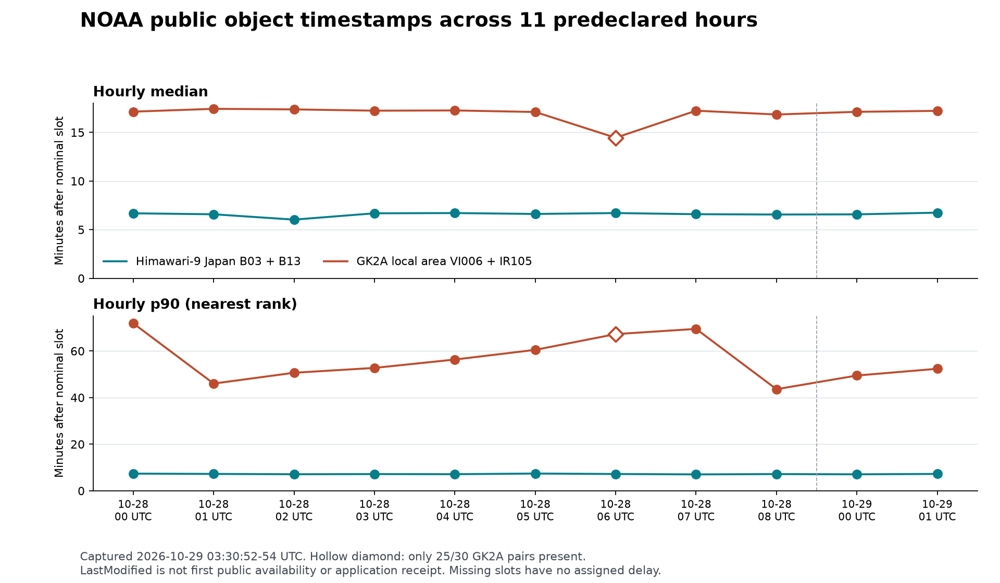

# Seoul satellite metadata comparison across eleven hours

Research captured October 29, 2026, **03:30:52–03:30:54 UTC / 12:30:52–12:30:54 KST**.

The broader sample continues to favor NOAA-distributed Himawari-9 Japan
B03/B13 pairs for earlier object timestamps. Across all ten hours with full
expected-pair coverage for both sources, its hourly median was **10m17s to
11m20s earlier** than GK2A local-area VI006/IR105. This strengthens the case
for testing Himawari as a cloud-signal input beyond the previously inspected
single hour. It establishes neither first public availability nor a validated
surface-radiation, temperature, or market advantage.

## Fixed scope and measurements

The window was fixed before this collection: October 28 UTC 00:00–08:59
(KST 09:00–17:59), plus October 29 UTC 00:00–01:59 (KST 09:00–10:59).
The latter includes the previously investigated 01 UTC hour; this is an
expanded audit, not an entirely unseen evaluation sample.

Exactly **22 public S3 listing requests** were made: one request for each
source/hour, `max-keys=1000`, without pagination, retries, or image downloads.
All responses were non-truncated and passed source, path, timestamp, size,
and XML-hash checks. No target object was rejected. The [capture manifest](assets/seoul-noaa-metadata-20261029/manifest.json)
records each URL, prefix, request/receipt clock, HTTP date, and uncompressed
XML SHA-256. Its `listings/` directory retains all 22 original responses in
gzip form. The [analysis evidence](assets/seoul-noaa-metadata-comparison-20261029.json)
retains all **594 expected slots**, including missing observations.

Himawari expects 24 slots per hour: six ten-minute timelines with JP01–JP04
offsets of 0, 2.5, 5, and 7.5 minutes. GK2A expects 30 slots, at even minute
boundaries. The analyzer requires exact source/path bindings: H09, Japan,
B03/R05 and B13/R20 with segment S0101; GK2A LA, VI006/la005ge and
IR105/la020ge. It rejects mismatched dates, hours, resolution, target paths,
ambiguous duplicate versions, negative delays, and timestamps after capture.

For each complete pair, delay is the later channel's S3 `LastModified` minus
its nominal slot. These clocks are not pixel acquisition, scan end, file
generation, first availability, or application insertion times. Modification
times can reflect later replacement. A complete listing only describes
objects present when requested; missing slots retain unknown outcomes.

## Results by day

These statistics use available complete pairs. The five missing GK2A slots
are shown in the denominator and are not assigned zero, infinite, or guessed
delays. The p90 uses the nearest rank, `ceil(0.9 × n)`, among sorted observed
delays. Medians average the two middle values when `n` is even.

| UTC date and hours | Source | Paired / expected | Median | p90 | Maximum |
| --- | --- | ---: | ---: | ---: | ---: |
| October 28, 00–08 | Himawari Japan | 216 / 216 | **6m40.5s** | **7m11s** | 8m23s |
| October 28, 00–08 | GK2A LA | **265 / 270** | 16m30s | **60m21s** | **77m53s** |
| October 29, 00–01 | Himawari Japan | 48 / 48 | **6m43s** | **7m11s** | 7m57s |
| October 29, 00–01 | GK2A LA | 60 / 60 | 17m07s | **51m28s** | **76m08s** |

On October 28, all five missing GK2A pairs were at **06:00, 06:02, 06:04,
06:06, and 06:08 UTC**. Both required bands were absent. The 06 hour has
25/30 complete pairs and no one-band-only slots; all other source/hour
combinations have full expected coverage. Their absence roughly 21 hours
later does not establish a scheduled gap, permanent loss, or the cause.
No additional request was made to resolve them in this audit.

Among October 28's 265 observed GK2A pairs, **54** had modification-time
delays over 30 minutes and **27** over 60 minutes. On October 29 the counts
were **12/60** and **1/60**. None of the 264 Himawari pairs in either window
exceeded ten minutes. These are counts within the retained windows, not
future reliability probabilities.

Restricting **both sources to the same eight fully covered October 28 hours**
(excluding 06 UTC) leaves Himawari 192 pairs at median **6m40.5s**, p90
**7m10s**, and GK2A 240 pairs at median **17m14s**, p90 **56m43s**. This
sensitivity check retains the direction of the source comparison. It does
not repair or hide the excluded hour's missing observations. Both October
29 hours were already fully covered.



## Every declared hour

All Himawari hours have 24/24 pairs. Asterisks identify statistics from the
incomplete GK2A hour; no paired median difference is assigned to that hour
in the machine-readable comparison.

| UTC hour | Himawari median / p90 | GK2A median / p90 | GK2A coverage |
| --- | ---: | ---: | ---: |
| October 28 00 | 6m41s / 7m22s | 17m08s / 71m53s | 30/30 |
| October 28 01 | 6m35s / 7m14s | 17m25.5s / 46m01s | 30/30 |
| October 28 02 | 6m02s / 7m06s | 17m22s / 50m39s | 30/30 |
| October 28 03 | 6m41s / 7m10s | 17m14s / 52m44s | 30/30 |
| October 28 04 | 6m42.5s / 7m07s | 17m15.5s / 56m20s | 30/30 |
| October 28 05 | 6m37s / 7m24s | 17m06s / 60m29s | 30/30 |
| October 28 06 | 6m42.5s / 7m12s | 14m27s* / 67m15s* | **25/30** |
| October 28 07 | 6m35.5s / 7m02s | 17m14s / 69m29s | 30/30 |
| October 28 08 | 6m33.5s / 7m10s | 16m50.5s / 43m36s | 30/30 |
| October 29 00 | 6m34.5s / 7m04s | 17m07s / 49m28s | 30/30 |
| October 29 01 | 6m45s / 7m14s | 17m13s / 52m22s | 30/30 |

The long GK2A tail is visible across multiple hours; it is not confined to
the original 01-hour example. Adjacent slots and hours share transfer batches
and operational conditions. They are dependent observations, and these two
dates do not estimate seasonal, outage, or between-day variation. A faster
retrospective timestamp also does not show when a client could download and
decode a usable RKSI pair. The separate first-seen probe addresses a different
clock with a much smaller prospective sample.

## Evidence, attribution, and reproduction

Public datasets are documented in the [NOAA Himawari registry](https://registry.opendata.aws/noaa-himawari/)
and [NOAA GK2A registry](https://registry.opendata.aws/noaa-gk2a-pds/).
Attribution: JMA Himawari-9 and KMA/NMSC GK2A, distributed through NOAA's AWS
Open Data repositories, accessed October 29, 2026. These comparative
calculations are derived work and imply no provider endorsement.

The [collector](../scripts/collect-noaa-satellite-metadata.py) contains the
fixed 22-request window and refuses to overwrite an existing capture. Do not
rerun collection to reproduce the present result: later object state can
change. The [offline analyzer](../scripts/analyze-noaa-satellite-metadata.py)
uses only the saved manifest and compressed XML:

```text
python scripts/analyze-noaa-satellite-metadata.py docs/assets/seoul-noaa-metadata-20261029/manifest.json tmp/noaa-metadata-reproduction.json
python -m unittest discover -s test -p test_noaa_satellite_metadata.py -v
```

Ten synthetic tests cover expected missing/unpaired slots, time offsets,
source/path/resolution rejection, hash mismatches, truncated listings and
archives, duplicate versions, fractional timestamp ordering, complete-hour
coverage, and the p90 definition. An independent code review found and fixed
fractional timestamp ordering and truncated-gzip handling before the final
analysis. Reproduction changes only the generated-at timestamp; the manifest
hash, all source evidence, and calculated results remain fixed.

A separate reconstruction generated every expected object key directly from
the fixed hours and channel rules, without importing the analyzer. It verified
all 22 XML hashes and 1,178 target objects, then reproduced every slot,
coverage count, delay, hourly/day summary and matched-complete-hour result.
It found no numerical correction necessary.

The [plotter](../scripts/plot-noaa-satellite-metadata.py) reads the analysis
JSON and requires Matplotlib. No production source, schema, schedule,
environment flag, credentials, approval state, or market action is changed
by this research.
